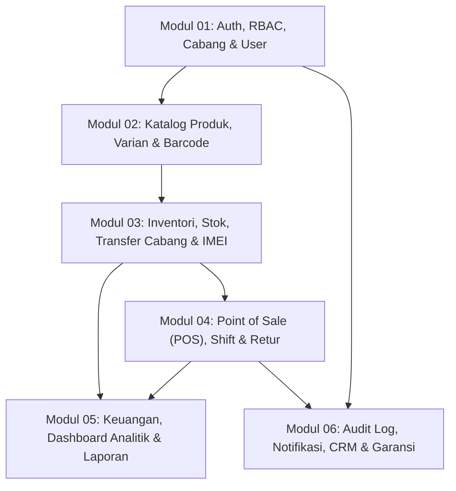

# Sistem Manajemen Toko Handphone Multi-Cabang — Dokumentasi PRD & Arsitektur

Selamat datang di repositori dokumentasi produk dan spesifikasi teknis **Sistem Manajemen Toko Handphone Multi-Cabang**. Dokumen di repositori ini disusun sebagai acuan tunggal (*Single Source of Truth*) bagi seluruh tim (Product, Frontend, Backend, dan QA) sebelum dan selama proses pengembangan berlangsung.

---

## 1. Gambaran Umum Proyek

Aplikasi ini adalah sistem **Web Fullstack (POS, Inventori & ERP Ringan)** yang dirancang khusus untuk jaringan ritel toko handphone yang memiliki banyak cabang.

### Masalah Utama yang Diselesaikan
- **Visibilitas Real-Time:** Pemilik (Super Admin) dapat memantau omzet, laba bersih, dan stok seluruh cabang dari satu dashboard tanpa menunggu rekap manual Excel/buku.
- **Kecepatan Transaksi Kasir (< 45 Detik):** Seluruh alur kasir, cek harga/spesifikasi, barang masuk, dan stock opname digerakkan oleh pemindaian **Barcode** (varian produk) dan **IMEI** (unit individual HP).
- **Isolasi & Keamanan Multi-Cabang:** Setiap cabang hanya dapat mengelola transaksi dan kasir di cabangnya sendiri, namun dapat melihat ketersediaan stok di cabang lain (*read-only*) untuk melayani pelanggan atau mengajukan transfer stok.
- **Anti-Kecurangan (Audit Trail):** Setiap perubahan stok (`StockMovement`) dan perubahan data sensitif seperti harga/diskon/retur (`ActivityLog`) bersifat *immutable* (tidak dapat dihapus/diedit).

---

## 2. Struktur Dokumentasi

Dokumentasi dibagi menjadi **1 PRD Utama (Executive & High-Level)** dan **6 PRD Modul Teknis (Siap Eksekusi Developer)**:

```text
.
├── README.md                                      # Panduan utama & navigasi tim (Dokumen ini)
├── PRD.md                                         # PRD Induk (Visi, Ringkasan Fitur, RBAC, Roadmap)
└── modules/                                       # PRD Turunan per Modul (Spesifikasi Detail Teknis)
    ├── 01-auth-branch-user.md                     # Modul 01: Auth, RBAC, Manajemen Cabang & User
    ├── 02-catalog-barcode.md                      # Modul 02: Katalog Produk, Varian & Sistem Barcode
    ├── 03-inventory-stock-imei.md                 # Modul 03: Stok, Barang Masuk, Transfer Cabang, Opname & IMEI
    ├── 04-pos-transaction-shift.md                # Modul 04: Point of Sale (Kasir), Shift, Struk & Retur
    ├── 05-finance-dashboard-reports.md            # Modul 05: Keuangan, Pengeluaran, Dashboard 3 Role & Laporan
    └── 06-crm-warranty-audit-settings.md          # Modul 06: Pelanggan, Garansi IMEI, Promo, Audit Log & Sistem
```

### Daftar Lengkap Dokumen & Cakupan Fitur

| Dokumen | Fokus & Cakupan Fitur | Kode Requirement | Target Fase |
| --- | --- | --- | --- |
| **[PRD Induk (`PRD.md`)](./PRD.md)** | Visi produk, latar belakang bisnis, matriks RBAC, metrik sukses, dan roadmap rilis | Semua (`AUTH` s/d `SET`) | Seluruh Fase |
| **[Modul 01: Auth, Cabang & User](./modules/01-auth-branch-user.md)** | Login, session cookie, isolasi data `branchId` di server, CRUD cabang, CRUD staf berjenjang | `AUTH-01`–`07`, `BR-01`–`04`, `USR-01`–`05` | **Fase 1** (Fondasi) |
| **[Modul 02: Katalog & Barcode](./modules/02-catalog-barcode.md)** | Master produk, multi-varian, *override* harga cabang, auto-barcode `Code128`, cetak label stiker, scan kamera/USB ke `/p/[barcode]` | `PRD-01`–`09`, `BC-01`–`10` | **Fase 2 & 3** (Master Data & Barcode) |
| **[Modul 03: Inventori, Stok & IMEI](./modules/03-inventory-stock-imei.md)** | Saldo stok per cabang, barang masuk, mutasi stok *immutable*, transfer stok antar cabang, stock opname, pelacakan unit per IMEI | `STK-01`–`09`, `BC-08`, `BC-10` | **Fase 3 & 6** (Stok & IMEI) |
| **[Modul 04: POS, Kasir, Shift & Retur](./modules/04-pos-transaction-shift.md)** | Layar kasir 2 panel, keranjang scan cepat, *split payment*, buka/tutup shift & selisih kas, cetak struk thermal 58/80mm + WA, retur & refund | `POS-01`–`13`, `BC-07` | **Fase 4** (POS & Transaksi) |
| **[Modul 05: Keuangan, Dashboard & Laporan](./modules/05-finance-dashboard-reports.md)** | Pencatatan pengeluaran cabang, kalkulasi HPP & Laba Bersih, Dashboard 3 Role (Super Admin, Admin Cabang, Kasir), export laporan Excel/PDF | `FIN-01`–`06`, `RPT-01`–`07` | **Fase 5** (Dashboard & Laporan) |
| **[Modul 06: CRM, Garansi, Audit & Sistem](./modules/06-crm-warranty-audit-settings.md)** | Database pelanggan, cek garansi otomatis via scan IMEI, tiket klaim servis, voucher promo, notifikasi in-app, `ActivityLog` (*before/after*) | `AUD-01`–`02`, `NTF-01`–`02`, `SET-01`–`02`, `CRM-01`–`02`, `WAR-01`–`02`, `PRO-01` | **Fase 1–6** (Lintas Fase) |

---

## 3. Peta Arsitektur & Alur Ketergantungan Modul

Diagram berikut menjelaskan urutan ketergantungan antar modul untuk memandu urutan pengerjaan (*sprint planning*):



---

## 4. Ringkasan Hak Akses (Role-Based Access Control)

Sistem memiliki 4 role pengguna dengan batasan akses data yang ditegakkan langsung di level server/database:

| Role | Cakupan Cabang | Tanggung Jawab Utama |
| --- | --- | --- |
| **`SUPER_ADMIN`** | **Semua Cabang** (Pusat) | Mengelola cabang, produk master, harga dasar, seluruh user, menyetujui transfer lintas cabang, memantau laporan laba rugi gabungan & audit log. |
| **`BRANCH_ADMIN`** | **Hanya Cabangnya** | Mengelola akun kasir/gudang cabangnya, barang masuk, stock opname, mengajukan/menerima transfer stok, menyetujui retur, mencatat pengeluaran cabang, dan melihat laporan cabangnya. |
| **`KASIR`** | **Hanya Cabangnya** (Terbatas) | Membuka/menutup shift kasir, memindai barcode/IMEI di POS, memproses pembayaran & cetak struk, mengecek stok cabang lain (*read-only*), serta mengajukan retur. *(Tidak dapat melihat HPP/Laba)*. |
| **`GUDANG`** *(Opsional)* | **Hanya Cabangnya** (Stok) | Mencatat barang masuk, mencetak stiker barcode, menyiapkan pengiriman transfer stok, dan melakukan perhitungan fisik stock opname. |

---

## 5. Tech Stack & Prinsip Teknis Wajib (Cross-Cutting Rules)

Seluruh engineer yang mengerjakan modul apa pun **wajib** mematuhi 5 kesepakatan arsitektur berikut:

### 5.1 Tech Stack Utama
- **Framework:** Next.js (App Router) + TypeScript
- **UI & Komponen:** Tailwind CSS + `shadcn/ui` (komponen inti & Recharts) + `Aceternity UI` (Bento Grid, Sidebar, Spotlight) + `React Bits` (CountUp animasi angka)
- **State, Tabel & Validasi:** TanStack Query, TanStack Table (server-side pagination), React Hook Form + `Zod`
- **Database & ORM:** PostgreSQL + Prisma ORM (atau Drizzle ORM)
- **Barcode & Cetak:** `react-barcode` / `JsBarcode` (generate SVG label), `@zxing/browser` / `html5-qrcode` (scan kamera) + listener *keyboard wedge* (scanner USB/Bluetooth)

### 5.2 Lima Aturan Emas Backend & Database
1. **Tanpa Float untuk Uang:** Semua kolom harga, modal (HPP), diskon, pajak, dan kas di database menggunakan `BigInt` (Rupiah penuh, contoh: `5999000`). Jangan pernah menggunakan `Float` untuk menghindari selisih pembulatan.
2. **Isolasi `branchId` di Server:** Jangan pernah mempercayai `branchId` dari *request body/query* milik `BRANCH_ADMIN` atau `KASIR`. Selalu gunakan helper `resolveBranchFilter(sessionContext)` untuk memaksa filter sesuai sesi login.
3. **Snapshot HPP Historis (`costPriceAtSale`):** Saat transaksi penjualan terjadi di POS, harga modal saat itu wajib disalin ke tabel `SaleItem.costPriceAtSale`. Jika di kemudian hari Super Admin mengubah harga modal produk, laporan laba rugi bulan-bulan sebelumnya tidak boleh berubah.
4. **Transaksi Atomik & Anti-Stok Negatif:** Operasi penjualan POS, barang masuk, transfer cabang, opname, dan retur wajib dibungkus dalam `prisma.$transaction` dengan pengecekan `WHERE qty >= requestedQty` (atau `SELECT ... FOR UPDATE`) serta constraint database `CHECK (qty >= 0)`.
5. **Buku Besar Stok & Audit Bersifat Immutable:** Tabel `StockMovement` dan `ActivityLog` hanya boleh menerima `INSERT` (*append-only*). Dilarang menyediakan fitur atau endpoint `UPDATE` maupun `DELETE` pada kedua tabel tersebut.

---

## 6. Panduan Membaca untuk Anggota Tim

- **Product Manager / Stakeholder:** Mulai dari [`PRD.md`](./PRD.md) untuk melihat ruang lingkup prioritas (`P0` MVP, `P1` Rilis 1.1, `P2` Rilis 1.2) dan bagian **2. User Stories & Acceptance Criteria** di setiap file dalam folder [`modules/`](./modules/).
- **Backend Engineer:** Pelajari bagian **3. Skema Database & Aturan Bisnis** serta **4. Spesifikasi API / Server Actions & Validasi Zod** di masing-masing file [`modules/01`](./modules/01-auth-branch-user.md) s/d [`modules/06`](./modules/06-crm-warranty-audit-settings.md).
- **Frontend / UI Engineer:** Pelajari bagian **11. Desain UI/UX** di [`PRD.md`](./PRD.md) dan bagian **5. Spesifikasi UI/UX & State Komponen** di setiap file dalam folder [`modules/`](./modules/).
- **QA Engineer:** Gunakan skenario **Gherkin (`Given / When / Then`)** pada setiap dokumen modul dan bagian **12. Kriteria Penerimaan** di [`PRD.md`](./PRD.md) sebagai basis pembuatan test case otomatis (Vitest & Playwright).
