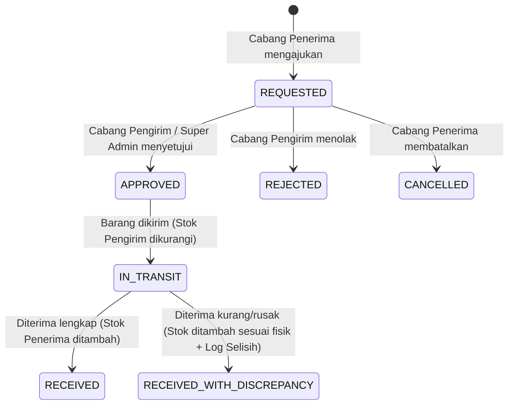

# PRD Modul 03: Manajemen Stok, Inventori, Transfer Cabang & IMEI

**Induk Dokumen:** [PRD.md](../PRD.md) · **Versi:** 1.0 · **Status:** Ready for Dev  
**Cakupan Requirement:** `STK-01` s/d `STK-09`, `BC-08`, `BC-10`

---

## 1. Tujuan & Ruang Lingkup Modul

Modul ini menjamin akurasi stok lintas cabang (target opname $\ge 98\%$), mencatat seluruh mutasi keluar-masuk barang secara *immutable* (tidak dapat dihapus/diubah), mengelola alur transfer barang antar cabang, dan melacak nomor IMEI/Serial per unit handphone.

### Cakupan Kebutuhan
| ID | Fitur | Prioritas | Target Rilis |
| --- | --- | --- | --- |
| `STK-01` | Stok per varian per cabang dengan batas stok minimum (`minQty`) | P0 | MVP (Fase 3) |
| `STK-02` | Pencatatan Barang Masuk (dari supplier/pusat) dengan nomor referensi, catatan, dan foto surat jalan | P0 | MVP (Fase 3) |
| `STK-03` | Buku besar pergerakan stok (`StockMovement`) bersifat *append-only* / *immutable* | P0 | MVP (Fase 3) |
| `STK-04` | Peringatan otomatis stok menipis (`qty <= minQty`) dan stok habis (`qty == 0`) | P0 | MVP (Fase 3) |
| `STK-08` | Pengecekan ketersediaan stok di cabang lain secara *real-time* (read-only) | P0 | MVP (Fase 3) |
| `STK-05` | Transfer stok antar cabang berstatus: `REQUESTED`, `APPROVED`, `IN_TRANSIT`, `RECEIVED`, `REJECTED` | P1 | Rilis 1.1 |
| `STK-06` | Stock Opname: input hitung fisik via scan/manual, kalkulasi selisih, dan *approval* penyesuaian | P1 | Rilis 1.1 |
| `STK-07` | Pelacakan IMEI/Serial per unit HP (`AVAILABLE`, `IN_TRANSIT`, `SOLD`, `RETURNED`, `SERVICE`) | P1 | Rilis 1.1 |
| `STK-09` | Purchase Order (PO) ke supplier dan pencatatan hutang jatuh tempo supplier | P2 | Rilis 1.2 |

---

## 2. User Stories & Acceptance Criteria (Gherkin)

### US-3.1: Penerimaan Barang Masuk & Input IMEI (`STK-02`, `STK-03`, `STK-07`)
**Sebagai** Admin Cabang, **saya ingin** mencatat barang masuk dari supplier atau gudang pusat dengan memindai barcode dan nomor IMEI **agar** stok cabang langsung bertambah dan setiap unit HP terlacak.

```gherkin
Scenario: Barang masuk untuk aksesoris (non-IMEI) dan HP (wajib IMEI)
  Given Admin Cabang "JKT-01" berada di halaman "/inventory/inbound"
  And stok awal "iPhone 15 128GB Black" (kategori HP) di "JKT-01" adalah 2 unit
  When Admin memindai barcode "iPhone 15 128GB Black" dengan qty = 2
  And memindai 2 nomor IMEI unik: "354987001122331" dan "354987001122332"
  And mengunggah foto nota surat jalan lalu menekan "Simpan Barang Masuk"
  Then dalam satu transaksi database atomic:
    1. Stok "iPhone 15 128GB Black" di "JKT-01" bertambah menjadi 4
    2. Tercatat 1 baris StockMovement bertipe "INBOUND" dengan qty = +2 dan balanceAfter = 4
    3. Tercatat 2 baris Unit (IMEI) dengan status "AVAILABLE" di branch "JKT-01"

Scenario: Gagal simpan barang masuk HP jika jumlah IMEI tidak sama dengan Qty
  Given produk termasuk kategori "HP" (requiresImei = true) dengan input Qty = 3
  When Admin hanya memasukkan 2 nomor IMEI
  Then validasi menolak penyimpanan dengan pesan "Produk kategori HP wajib menyertakan tepat 3 nomor IMEI unik"
```

### US-3.2: Alur Transfer Stok Antar Cabang (`STK-05`)
**Sebagai** Admin Cabang A, **saya ingin** meminta transfer stok dari Cabang B yang kelebihan stok **agar** permintaan pelanggan di Cabang A tetap terpenuhi.

```gherkin
Scenario: Siklus penuh transfer stok dari pengajuan hingga penerimaan
  Given Cabang "BDG-01" memiliki stok 5 unit dan Cabang "JKT-01" memiliki stok 0 unit untuk varian V1
  When Admin "JKT-01" membuat permintaan transfer 2 unit V1 dari "BDG-01"
  Then status transfer adalah "REQUESTED" dan stok "BDG-01" belum berkurang
  When Admin "BDG-01" menyetujui dan klik "Kirim Barang" (memilih 2 IMEI jika kategori HP)
  Then status transfer berubah menjadi "IN_TRANSIT"
  And stok tersedia di "BDG-01" langsung berkurang menjadi 3 unit (mencegah terjual ganda di BDG-01)
  And tercatat StockMovement "TRANSFER_OUT" (-2) di "BDG-01"
  When Admin "JKT-01" menerima paket fisik dan mengonfirmasi penerimaan 2 unit
  Then status transfer berubah menjadi "RECEIVED"
  And stok tersedia di "JKT-01" bertambah menjadi 2 unit
  And tercatat StockMovement "TRANSFER_IN" (+2) di "JKT-01"

Scenario: Penerimaan transfer dengan selisih (Discrepancy / Barang Rusak atau Kurang)
  Given transfer berstatus "IN_TRANSIT" dengan qty dikirim = 5 unit
  When cabang penerima mengonfirmasi qty diterima baik hanya 4 unit (1 unit hilang/rusak di ekspedisi)
  Then stok cabang penerima bertambah +4 unit
  And 1 unit selisih otomatis dicatat pada kolom "discrepancyQty" beserta berita acara untuk investigasi Super Admin
  And mengirim notifikasi prioritas tinggi ke Super Admin
```

### US-3.3: Stock Opname & Penyesuaian Stok (`STK-06`)
**Sebagai** Admin Cabang, **saya ingin** melakukan penghitungan fisik stok secara berkala **agar** selisih antara catatan sistem dan fisik terdeteksi serta dikoreksi secara sah.

```gherkin
Scenario: Sesi Stock Opname dengan selisih stok
  Given sesi opname dibuka untuk cabang "SBY-01"
  And sistem mencatat stok "AirPods Pro 2" sebanyak 10 unit
  When staf gudang memindai fisik dan menginput qty fisik = 9 unit (selisih -1) dengan alasan "1 unit hilang di etalase"
  And Admin Cabang/Super Admin menekan "Setujui & Sesuaikan Stok"
  Then stok sistem diperbarui menjadi 9 unit
  And tercatat StockMovement bertipe "OPNAME_ADJUSTMENT" dengan qty = -1, balanceAfter = 9, dan referensi ID Opname
  And tercatat di ActivityLog
```

---

## 3. Skema Database & Aturan Bisnis

### 3.1 Definisi Tabel (Prisma-style Schema)

```prisma
enum MovementType {
  INBOUND            // Barang masuk dari supplier/pusat (+)
  SALE_OUT           // Terjual di POS (-)
  RETURN_IN          // Retur dari pelanggan (+)
  RETURN_SUPPLIER    // Retur ke supplier (-)
  TRANSFER_OUT       // Dikirim ke cabang lain (-)
  TRANSFER_IN        // Diterima dari cabang lain (+)
  OPNAME_ADJUSTMENT  // Koreksi hasil stock opname (+/-)
}

enum TransferStatus {
  REQUESTED
  APPROVED
  IN_TRANSIT
  RECEIVED
  RECEIVED_WITH_DISCREPANCY
  REJECTED
  CANCELLED
}

enum UnitStatus {
  AVAILABLE
  IN_TRANSIT
  SOLD
  RETURNED
  SERVICE
  DEFECTIVE
}

model Stock {
  id        String   @id @default(cuid())
  variantId String
  branchId  String
  qty       Int      @default(0) // Wajib >= 0 (Database CHECK constraint: qty >= 0)
  minQty    Int      @default(2) // Batas peringatan stok menipis
  updatedAt DateTime @updatedAt

  @@unique([variantId, branchId])
  @@index([branchId, qty])
}

model StockMovement {
  id           String       @id @default(cuid())
  variantId    String
  branchId     String
  type         MovementType
  qtyChange    Int          // Positif (+) untuk masuk, Negatif (-) untuk keluar
  balanceAfter Int          // Snapshot saldo stok tepat setelah mutasi ini
  referenceType String      // "INBOUND", "SALE", "TRANSFER", "OPNAME", "RETURN"
  referenceId  String
  notes        String?      @db.Text
  attachmentUrl String?     // Foto surat jalan / bukti fisik
  userId       String
  createdAt    DateTime     @default(now())

  // Tabel ini TIDAK memiliki updatedAt atau deletedAt karena bersifat IMMUTABLE
  @@index([branchId, variantId, createdAt(sort: Desc)])
  @@index([referenceType, referenceId])
}

model Unit {
  id                String     @id @default(cuid())
  variantId         String
  branchId          String
  imei              String     @unique @db.VarChar(30) // IMEI 1 (15 digit) atau Serial Number
  imei2             String?    @db.VarChar(30)
  status            UnitStatus @default(AVAILABLE)
  costPriceSnapshot BigInt     // HPP spesifik unit ini saat masuk
  inboundRefId      String?
  saleItemId        String?
  warrantyEndsAt    DateTime?
  createdAt         DateTime   @default(now())
  updatedAt         DateTime   @updatedAt

  @@index([branchId, variantId, status])
  @@index([imei])
}

model StockTransfer {
  id             String              @id @default(cuid())
  transferNumber String              @unique @db.VarChar(30) // Contoh: TRF-202610-0001
  fromBranchId   String              // Cabang pengirim (sumber stok)
  toBranchId     String              // Cabang peminta/penerima
  status         TransferStatus      @default(REQUESTED)
  requestedById  String
  approvedById   String?
  shippedById    String?
  receivedById   String?
  notes          String?             @db.Text
  requestedAt    DateTime            @default(now())
  approvedAt     DateTime?
  shippedAt      DateTime?
  receivedAt     DateTime?

  items          StockTransferItem[]
  @@index([fromBranchId, status])
  @@index([toBranchId, status])
}

model StockTransferItem {
  id             String        @id @default(cuid())
  transferId     String
  variantId      String
  requestedQty   Int
  shippedQty     Int?
  receivedQty    Int?
  discrepancyQty Int           @default(0)
  unitIds        String[]      // Daftar ID Unit (IMEI) yang ikut dikirim
  notes          String?

  transfer       StockTransfer @relation(fields: [transferId], references: [id], onDelete: Cascade)
}
```

### 3.2 Diagram State Transfer Stok Antar Cabang



### 3.3 Aturan Bisnis & Pencegahan Race Condition
1. **Constraint Stok Non-Negatif:** Di PostgreSQL, tambahkan constraint `ALTER TABLE "Stock" ADD CONSTRAINT stock_qty_non_negative CHECK (qty >= 0);`.
2. **Row-Level Locking (`SELECT ... FOR UPDATE`):** Setiap operasi pengurangan atau penambahan stok wajib mengeksekusi transaksi dengan mengunci baris `Stock` terlebih dahulu atau menggunakan operasi atomik `UPDATE "Stock" SET qty = qty - $1 WHERE variant_id = $2 AND branch_id = $3 AND qty >= $1 RETURNING qty`. Jika baris yang ter-update adalah `0`, lempar error `409 INSUFFICIENT_STOCK`.
3. **Immutability `StockMovement`:** Tidak boleh ada endpoint `UPDATE` atau `DELETE` untuk tabel `StockMovement`. Jika terjadi salah input barang masuk, koreksi harus dilakukan melalui transaksi penyesuaian baru (*reversal entry*) sehingga jejak audit tetap utuh.

---

## 4. Spesifikasi API / Server Actions & Validasi Zod

### 4.1 Skema Validasi Zod

```typescript
import { z } from 'zod';

export const InboundStockSchema = z.object({
  branchId: z.string().min(1),
  supplierName: z.string().max(100).optional(),
  invoiceNumber: z.string().max(60).optional(),
  attachmentUrl: z.string().url().optional(),
  notes: z.string().max(1000).optional(),
  items: z.array(z.object({
    variantId: z.string().min(1),
    qty: z.number().int().positive('Qty harus minimal 1'),
    unitCostPrice: z.number().int().nonnegative().optional(),
    imeis: z.array(z.string().regex(/^[0-9A-Za-z-]{8,25}$/, 'Format IMEI/Serial tidak valid')).optional(),
  })).min(1, 'Minimal 1 item barang masuk'),
});

export const CreateTransferRequestSchema = z.object({
  fromBranchId: z.string().min(1),
  toBranchId: z.string().min(1),
  notes: z.string().max(500).optional(),
  items: z.array(z.object({
    variantId: z.string().min(1),
    requestedQty: z.number().int().positive(),
  })).min(1),
}).refine((data) => data.fromBranchId !== data.toBranchId, {
  message: 'Cabang asal dan cabang tujuan tidak boleh sama',
  path: ['toBranchId'],
});

export const ReceiveTransferSchema = z.object({
  transferId: z.string().min(1),
  items: z.array(z.object({
    transferItemId: z.string().min(1),
    receivedQty: z.number().int().nonnegative(),
    notes: z.string().max(300).optional(),
  })).min(1),
});
```

### 4.2 Daftar Endpoint / Server Actions

| Action / Endpoint | Metode | Role Diizinkan | Deskripsi & Error Codes |
| --- | --- | --- | --- |
| `GET /api/inventory` | GET | Semua Role | Daftar stok cabang aktif (atau semua cabang bagi Super Admin), filter status (`ALL`, `LOW_STOCK`, `OUT_OF_STOCK`). |
| `POST /api/inventory/inbound` | POST | `SUPER_ADMIN`, `BRANCH_ADMIN`, `GUDANG` | Catat barang masuk + daftar IMEI. Error: `400 IMEI_COUNT_MISMATCH`, `409 IMEI_ALREADY_REGISTERED`. |
| `GET /api/inventory/movements` | GET | `SUPER_ADMIN`, `BRANCH_ADMIN`, `GUDANG` | Kartu stok / buku besar mutasi per varian & cabang. |
| `POST /api/inventory/transfers` | POST | `SUPER_ADMIN`, `BRANCH_ADMIN` | Ajukan transfer stok antar cabang. |
| `PATCH /api/inventory/transfers/:id/ship` | PATCH | `SUPER_ADMIN`, `BRANCH_ADMIN` (cabang pengirim) | Setujui & kirim barang (`IN_TRANSIT`), potong stok cabang pengirim secara atomik. Error: `409 INSUFFICIENT_STOCK`. |
| `PATCH /api/inventory/transfers/:id/receive` | PATCH | `SUPER_ADMIN`, `BRANCH_ADMIN` (cabang penerima) | Konfirmasi barang tiba, tambah stok cabang penerima. |
| `POST /api/inventory/opname` | POST | `SUPER_ADMIN`, `BRANCH_ADMIN` | Submit dan *approve* hasil stock opname untuk menyesuaikan saldo sistem. |
| `GET /api/inventory/units/:imei` | GET | Semua Role | Lacak posisi cabang, status, riwayat pembelian, dan masa garansi sebuah IMEI (`BC-10`). |

---

## 5. Spesifikasi UI/UX & State Komponen

### 5.1 Tabel Inventori & Kartu Stok (`/inventory`)
- **Quick Filter Pills di Atas Tabel:** `Semua (240)`, `Stok Menipis (12)` (badge kuning), `Stok Habis (4)` (badge merah), `Kategori: HP`.
- **Drawer "Kartu Stok" (Klik Baris):** Menampilkan *timeline* mutasi barang tersebut (tanggal, jam, tipe mutasi dengan badge warna, perubahan `+5` / `-1`, saldo akhir, nama staf, dan link ke nomor invoice/transfer).

### 5.2 Form Barang Masuk & Stock Opname Berbasis Scan (`/inventory/inbound` & `/inventory/opname`)
- **Input Scan Cepat:** Saat berada di halaman Barang Masuk atau Opname, setiap scan barcode varian langsung menambahkan baris item ke tabel kerja.
- **Pop-up Scan IMEI Beruntun:** Untuk item berjenis `HP`, muncul modal kecil *"Scan 5 IMEI untuk iPhone 15 128GB"*. Staf cukup menembakkan scanner ke 5 kotak HP secara berurutan; setiap scan otomatis mengisi baris 1 s/d 5, memvalidasi duplikasi secara *real-time*, dan menutup modal otomatis saat jumlah terpenuhi.

### 5.3 Papan Kanban / Tabel Transfer Cabang (`/inventory/transfers`)
- Dua tab utama untuk Admin Cabang: **"Permintaan Masuk (Perlu Dikirim)"** dan **"Permintaan Keluar (Menunggu Barang Tiba)"**.
- Stepper visual status pengiriman (`Diajukan` → `Disetujui` → `Dalam Pengiriman` → `Diterima`).

